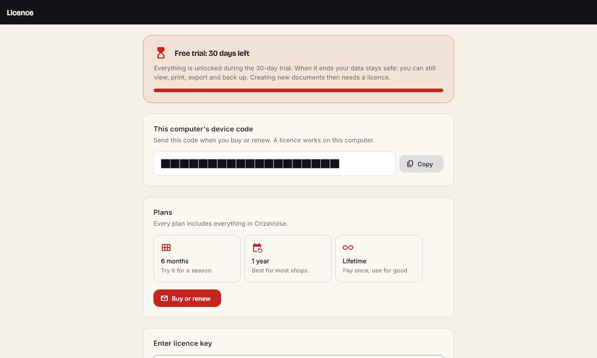

<div align="center">
  

  <p><strong>CrizaVoise by Criza Labs</strong> — simple, offline invoicing and billing for small businesses.</p>
  <p>Windows · Linux · macOS</p>
</div>

---

> **Proprietary software.** © 2026 Criza Labs. All rights reserved. See [LICENSE](LICENSE).
> Portions are based on open-source software; their notices are in [THIRD_PARTY_NOTICES.md](THIRD_PARTY_NOTICES.md) and in the app under **Settings → About → Open-source licenses**.

## What it does
- **Bills in seconds:** a "Quick bill" for walk-in customers, product quick codes (type `R5` + Enter), product photos, and voice typing.
- **Documents:** PDF invoices, quotations, receipts and credit/debit notes. Several templates in CrizaVoise colours, with your logo (any size), signature and watermark. Thermal receipts too.
- **GST-ready:** GSTIN, HSN/SAC, per-item or global tax, a UPI QR code, and custom invoice numbers with an audit trail.
- **Getting paid:** share an invoice on WhatsApp, send payment reminders by WhatsApp or SMS, and track payments, the cash/UPI ledger and reports (CSV/PDF).
- **Stock and suppliers:** customers, products, stock, purchase bills, suppliers and returns.
- **Team and security:** multiple companies, admin and standard users, quick PIN sign-in, recovery codes and session timeout.
- **For everyone:** 8 languages, including Hindi and Gujarati; read-aloud; large number pad; reduce motion; and screen-reader labels.
- **Licensing:** a free 30-day trial, then 6-month, 1-year or lifetime licences. Data is never locked: viewing, printing and export always work.
- **100% offline:** data stays in a local SQLite database, with built-in backup and restore. No tracking.

## Screenshots
| Dashboard (light) | Dashboard (dark) |
|---|---|
|  |  |
| **New invoice** | **Invoices** |
|  |  |
| **Products (dark)** | **Licence** |
|  |  |
| **First run: create your account** | |
|  | |

Regenerate them with `SCREENSHOTS=1 flutter test test/screenshots/app_screenshots_test.dart` (written to `build/screenshots`).

## Development

| | |
|---|---|
| Stack | Flutter 3 (desktop), Riverpod, sqflite + sqflite_common_ffi, `pdf` + `printing`, ARB l10n |
| SDK | Flutter stable (3.47+) · on Windows: Visual Studio 2022 Build Tools (C++) and **Developer Mode** on |

```bash
flutter pub get
flutter gen-l10n              # after editing lib/l10n/*.arb
flutter analyze
flutter test
flutter run -d windows        # or linux / macos
flutter build windows         # → build/windows/x64/runner/Release/crizavoise.exe
ISCC.exe installer.iss        # → dist/CrizaVoise-Setup-1.0.0.exe (Inno Setup 6)
dart run flutter_launcher_icons   # after changing assets/brand/icons/icon-1024.png
```

**Where data lives**
- Windows: `%APPDATA%\Criza Labs\CrizaVoise\`
- Linux: `~/.local/share/dev.criza.crizavoise/`
- macOS: `~/Library/Application Support/dev.criza.crizavoise/`

**More docs**
- Brand guidelines: [docs/brand.md](docs/brand.md)
- Licensing and the licence admin app: [docs/licensing.md](docs/licensing.md), [tool/license-admin](tool/license-admin/README.md)
- Performance baseline: [docs/performance.md](docs/performance.md)
- Design tokens: `lib/theme/tokens.dart`
- Contributor and AI-session notes: [CLAUDE.md](CLAUDE.md)

## Credits
Made by **Criza Labs** — https://criza.dev
