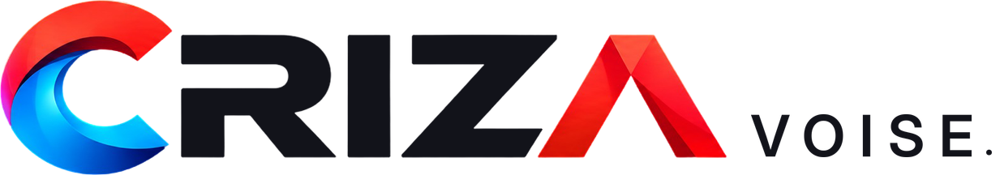
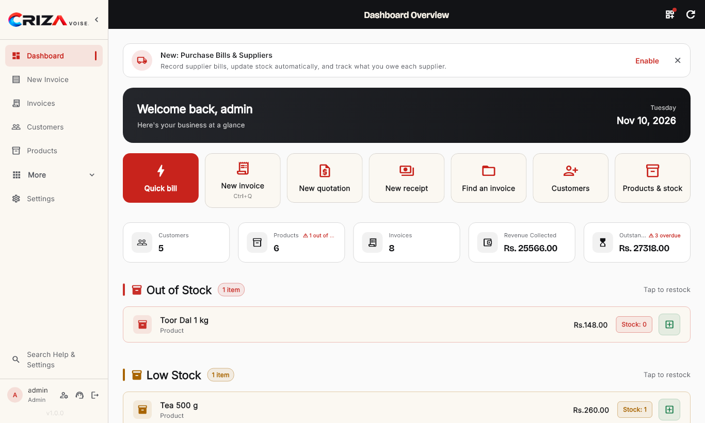
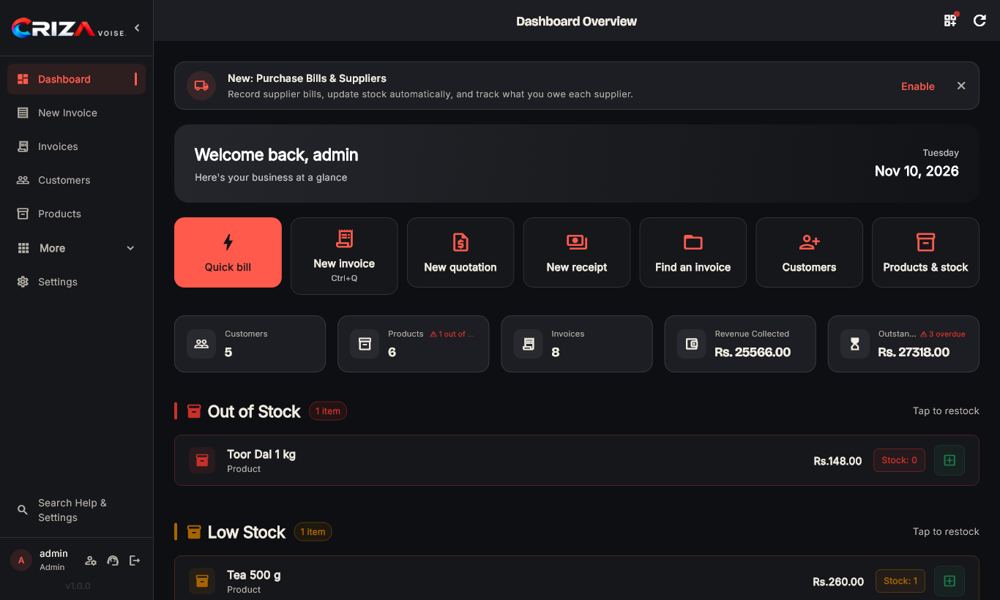
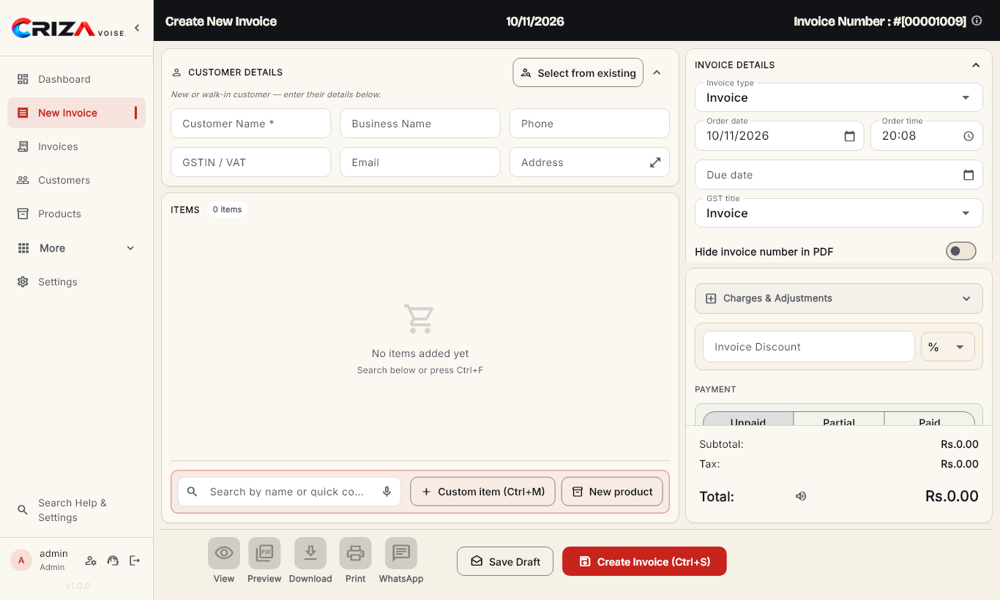
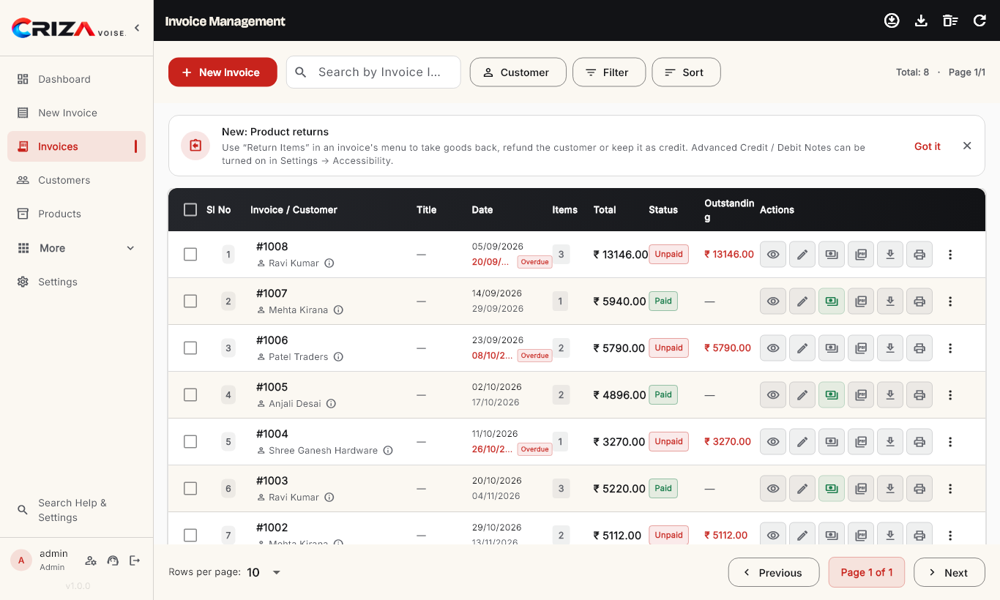
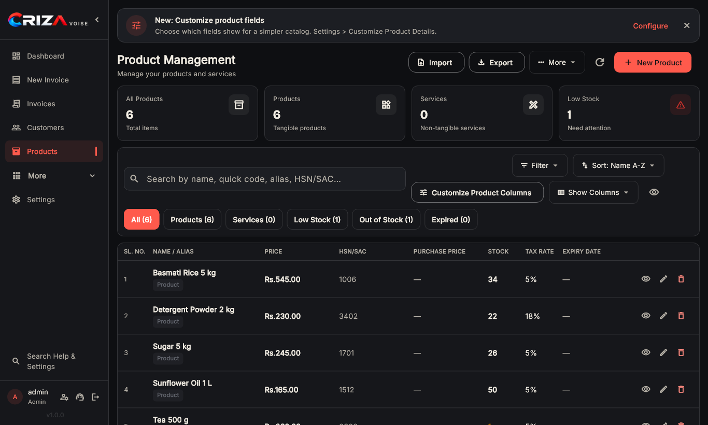
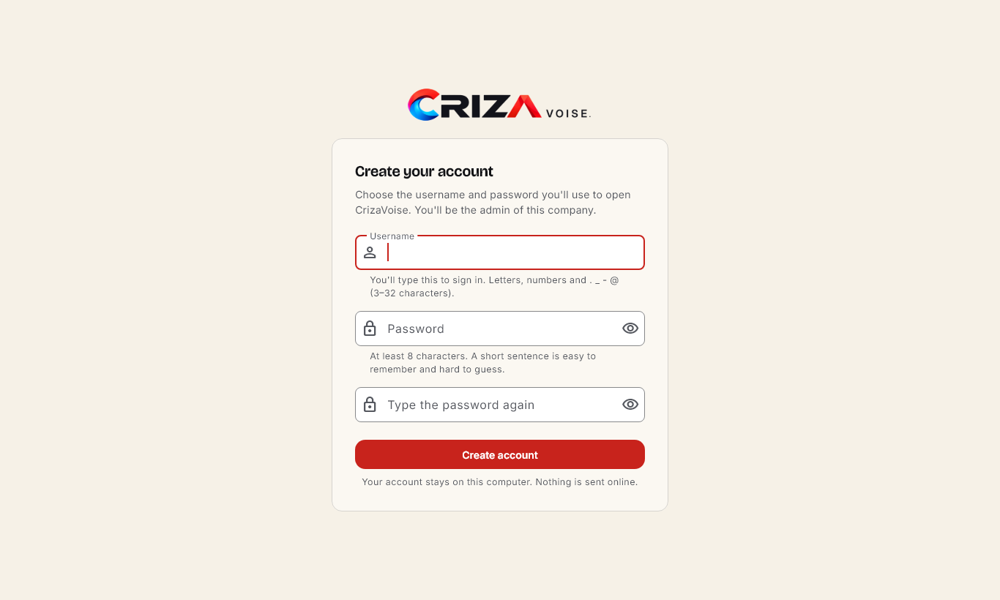

<div align="center">
  <picture>
    <source media="(prefers-color-scheme: dark)" srcset="assets/brand/lockup-dark.png" />
    
  </picture>

  <h1>CrizaVoise: free, open-source invoicing and billing software</h1>

  <p><strong>Offline GST invoice, billing and stock app for small businesses on Windows, Linux and macOS.</strong><br/>
  Made by <a href="https://criza.dev">Criza Labs</a>.</p>

  <p>
    <a href="https://github.com/CRIZA-LABS/crizavoise/releases/latest"></a>
    <a href="LICENSE"></a>
    
    
    
  </p>

  <p><a href="https://github.com/CRIZA-LABS/crizavoise/releases/latest"><strong>Download</strong></a> · <a href="#features">Features</a> · <a href="#screenshots">Screenshots</a> · <a href="#faq">FAQ</a> · <a href="CONTRIBUTING.md">Contribute</a></p>
</div>

---

**CrizaVoise** is a free, open-source desktop app for making invoices and bills. Small shops, freelancers and small businesses use it to create GST-ready PDF invoices, quotations and receipts, print thermal receipts, track payments and stock, and share invoices on WhatsApp. It runs fully offline: your data stays on your computer. There is no subscription, trial or sign-up. CrizaVoise is made by [Criza Labs](https://criza.dev) and released under the Apache License 2.0.

> **Fork it, use it, ship it: just give credit.** Keep [LICENSE](LICENSE) and [NOTICE](NOTICE), and show **"Based on CrizaVoise by Criza Labs (https://criza.dev)"** in your README and About screen. Use your own name and logo ([TRADEMARKS.md](TRADEMARKS.md)).

## Download
Get the latest version from **[Releases](https://github.com/CRIZA-LABS/crizavoise/releases/latest)**:

| Platform | File |
|---|---|
| Windows 10 / 11 | `CrizaVoise-Setup-<version>.exe` |
| Ubuntu / Debian | `.deb` for Ubuntu 22.04 or 24.04 |
| Any Linux | AppImage |
| macOS | `crizavoise-<version>-macos.dmg` |

The installers are not code-signed yet. On Windows, choose **More info → Run anyway**. On macOS, open **System Settings → Privacy & Security** and click **Open Anyway**.

## Who it's for
- **Retail shops and kirana stores** that need fast counter billing and thermal receipts.
- **Small businesses and traders in India** that need GST invoices with GSTIN, HSN/SAC and UPI QR codes.
- **Freelancers and service businesses** that send quotations and invoices as PDFs.
- **Anyone who wants billing software without a subscription**, without the cloud, and without giving their data to anyone.
- **Developers** who want a Flutter desktop codebase to learn from or build on.

## Features
- **Bills in seconds:** a "Quick bill" for walk-in customers, product quick codes (type `R5` + Enter), product photos, and voice typing.
- **Documents:** PDF invoices, quotations, receipts and credit/debit notes. Several templates in CrizaVoise colours, with your logo (any size), signature and watermark. Thermal receipts too.
- **GST-ready:** GSTIN, HSN/SAC, per-item or global tax, a UPI QR code, and custom invoice numbers with an audit trail.
- **Getting paid:** share an invoice on WhatsApp, send payment reminders by WhatsApp or SMS, and track payments, the cash/UPI ledger and reports (CSV/PDF).
- **Stock and suppliers:** customers, products, stock, purchase bills, suppliers and returns.
- **Team and security:** multiple companies, admin and standard users, quick PIN sign-in, recovery codes and session timeout.
- **For everyone:** 8 languages, including Hindi and Gujarati; read-aloud; large number pad; reduce motion; and screen-reader labels.
- **Free:** no trial, no subscription, no licence key, no ads.
- **100% offline:** data stays in a local SQLite database, with built-in backup and restore. No tracking.

## Screenshots
| Dashboard (light) | Dashboard (dark) |
|---|---|
|  |  |
| **New invoice** | **Invoices** |
|  |  |
| **Products (dark)** | **First run: create your account** |
|  |  |

Regenerate them with `SCREENSHOTS=1 flutter test test/screenshots/app_screenshots_test.dart` (written to `build/screenshots`).

## FAQ

### What is CrizaVoise?
CrizaVoise is a free, open-source invoicing and billing app for Windows, Linux and macOS. It makes PDF invoices, quotations, receipts and credit/debit notes, prints thermal receipts, and tracks customers, products, stock, payments and suppliers. It is made by Criza Labs (https://criza.dev).

### Is CrizaVoise really free?
Yes. There is no price, trial, subscription, licence key or ads. The source code is under the Apache License 2.0, so businesses can also use it commercially.

### Does CrizaVoise work offline?
Yes. It works fully without the internet. All data is stored in a local SQLite database on your computer, and nothing is sent to a server.

### Can I make GST invoices with CrizaVoise?
Yes. Invoices can show your GSTIN, HSN/SAC codes, per-item or overall tax, and a UPI QR code for payment. CrizaVoise is a record-keeping tool, so check your invoices against current GST rules or with your accountant.

### Does it print on thermal receipt printers?
Yes. It prints receipts on ESC/POS thermal printers and makes full-page A4 PDF invoices.

### Which languages does it support?
English, Hindi, Gujarati, Spanish, French, Nepali, Chinese and Tibetan.

### Where is my data stored, and how do I back it up?
On your own computer: `%APPDATA%\Criza Labs\CrizaVoise\` on Windows, `~/.local/share/dev.criza.crizavoise/` on Linux and `~/Library/Application Support/dev.criza.crizavoise/` on macOS. Use **Settings → Backup** to save a copy, and keep it somewhere safe.

### Can I fork CrizaVoise or use the code in my own product?
Yes, under the Apache License 2.0. Keep the LICENSE and NOTICE files, credit **"Based on CrizaVoise by Criza Labs (https://criza.dev)"**, and give your version its own name and logo.

### Can Criza Labs build a custom version for my business?
Yes. For custom builds, white-label versions or support, write to connect@criza.dev or visit https://criza.dev.

## Development

| | |
|---|---|
| Stack | Flutter 3 (desktop), Riverpod, sqflite + sqflite_common_ffi, `pdf` + `printing`, ARB l10n |
| SDK | Flutter stable (3.47+) · on Windows: Visual Studio 2022 Build Tools (C++) and **Developer Mode** on |

```bash
flutter pub get
flutter gen-l10n              # after editing lib/l10n/*.arb
flutter analyze
flutter test
flutter run -d windows        # or linux / macos
flutter build windows         # → build/windows/x64/runner/Release/crizavoise.exe
ISCC.exe installer.iss        # → dist/CrizaVoise-Setup-1.0.0.exe (Inno Setup 6)
dart run flutter_launcher_icons   # after changing assets/brand/icons/icon-1024.png
```

**Where data lives**
- Windows: `%APPDATA%\Criza Labs\CrizaVoise\`
- Linux: `~/.local/share/dev.criza.crizavoise/`
- macOS: `~/Library/Application Support/dev.criza.crizavoise/`

**More docs**
- Brand guidelines: [docs/brand.md](docs/brand.md)
- Optional licence-key system (switched off; `AppConfig.licensingEnabled`): [docs/licensing.md](docs/licensing.md), [tool/license-admin](tool/license-admin/README.md)
- Performance baseline: [docs/performance.md](docs/performance.md)
- Design tokens: `lib/theme/tokens.dart`
- Contributor and AI-session notes: [CLAUDE.md](CLAUDE.md)

## Contributing
Issues and pull requests are welcome. See [CONTRIBUTING.md](CONTRIBUTING.md).

## License and credit
CrizaVoise is licensed under the [Apache License 2.0](LICENSE). Under that licence, anyone who redistributes this code or a version based on it must keep the [NOTICE](NOTICE) file. We ask that forks show this line in their README and About screen:

> Based on CrizaVoise by Criza Labs (https://criza.dev)

The CrizaVoise and Criza Labs names and logos are not covered by the code licence. See [TRADEMARKS.md](TRADEMARKS.md).

CrizaVoise started from [Invoiso](https://github.com/Anooppandikashala/invoiso) (MIT). Its notice and every other third-party licence are in [THIRD_PARTY_NOTICES.md](THIRD_PARTY_NOTICES.md) and in the app under **Settings → About → Open-source licenses**.

## Credits
Made by **Criza Labs** — https://criza.dev. Need a custom build or help for your business? Write to connect@criza.dev.
